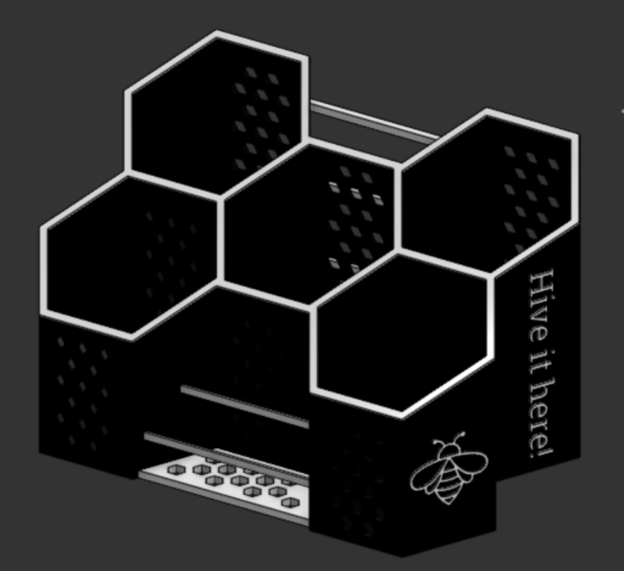
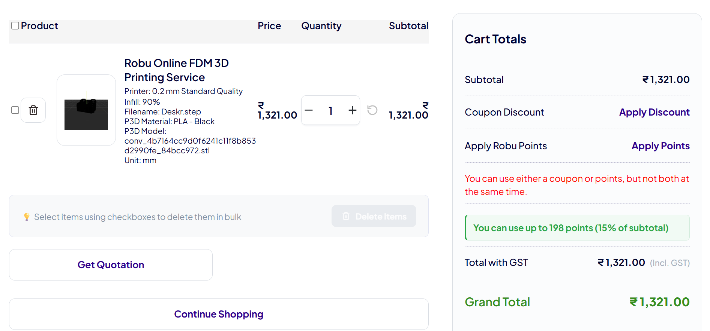

# deskr
Deskr is a simple stand that sits on your table and does a lowkey job of categorizing/organising your stuff.

## What is this?
Deskr is an organiser for all the stuff on your desk that makes it look messy. Deskr is divided into sections at different heights to hold different types of items.



## Repository Structure
```text
deskr/
|
|---- Assets/-----------# Images and visual references for the project
|
|---- Hardware/---------# Source design file for the CAD
|
|---- BOM.csv-----------# Bill of Material
|
|---- LICENSE-----------# MIT License
|
|---- README.md---------# Project documentation and instructions
```

## Live 3d view in Onshape
Click [here](https://cad.onshape.com/documents/107dcb341132d77605ee247c/w/14892f947c2b0efa74e5cc21/e/358faa5190515ad476abbf8d) to view Deskr in Onshape!

## How to get your own Deskr?
1. Download the source CAD .step file from the [Hardware](Hardware/) directory
2. Import the file into your CAD editor and make edits as you want (Optional)
3. Go to your fabricater/ manufacturer website, get a quote, and purchase it (For Example, [ROBU](robu.in) or [JLCPCB](jlcpcb.com))
4. That's it! Wait for it to arrive and go organize your stuff!
5. You will possibly get a solid black pla 3d print. To make the text and renders contrast with it, you will have to paint it with a color like white or yellow!

## Fabrication Specs
1. Printer- 0.2 mm Standard Quality
2. Material- PLA
3. Color- Black
4. Infill- 60%

## [BOM](BOM.csv) as a table
| Item                | Quantity | Price (USD) | Link    |
|---------------------|----------|-------------|---------|
| 3D Print (PLA)      | 1        | 13.2        | robu.in |
| Shipping & Handling |          | 1           |         |
| Total               |          | 14.2        |         |

## Cart Image


## License
[MIT](LICENSE)- Use, modify, share as you like!

## Notes
- If ya'll like this project, make sure to see my other projects [NFC Card](https://github.com/vd-sh/nfc-card), [Cookie Cutters](https://github.com/vd-sh/cookie-cutters), or [Key Rings](https://github.com/vd-sh/key-rings)
- Or simply visit my [profile](https://github.com/vd-sh) to see the latest projects :)
